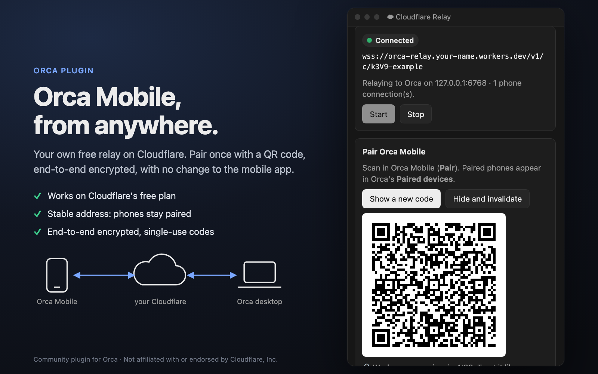

# Orca Cloudflare Relay



> Community plugin for Orca. Not affiliated with or endorsed by Cloudflare, Inc.

An [Orca](https://github.com/stablyai/orca) plugin that adds a third way for **Orca Mobile**
to reach your desktop, alongside **LAN** and **Orca Relay**: **your own relay on Cloudflare's
free plan**. That is either a one-click Worker + Durable Object relay, or a Cloudflare Tunnel.

The phone app needs **no update and no extra steps**. You pair with a normal Orca QR code, just
as you do over LAN. The only difference is the address the phone dials, which is served by
Cloudflare instead of a LAN IP.

## Three connection types

| | **Worker relay** (recommended) | Tunnel on your domain | Quick tunnel |
| --- | --- | --- | --- |
| Needs | free Cloudflare account | free account + a domain on it | nothing |
| Address | stable `orca-relay.<you>.workers.dev` | stable `orca.example.com` | random `*.trycloudflare.com` |
| After restarting Orca | phone stays paired | phone stays paired | **address changes, pair again** |
| Installs on desktop | nothing | `cloudflared` (auto, checksum-verified) | `cloudflared` |

### Worker relay (Worker + Durable Object, Free plan)

```
Orca Mobile ──wss /v1/c/<hostId>──▶ Cloudflare Worker ─▶ RelayHost Durable Object
                                                              ▲   (splices sockets)
Orca desktop ── plugin bridge ──wss control + data sockets────┘
      └─▶ ws://127.0.0.1:6768 (Orca's own mobile server, same as LAN)
```

- `worker/src/index.js` is a dependency-free Worker with one SQLite-backed Durable Object per
  desktop. It runs on the Workers Free plan.
- The plugin keeps an outbound **control** socket to the Durable Object. When a phone connects,
  the Durable Object asks the desktop to open a **data** socket. The plugin opens that socket,
  plus a local socket to Orca's mobile server, and splices them. To Orca, the phone looks like a
  LAN client.
- The relay is a blind pipe. Orca's end-to-end encryption (keys pinned from the QR code) runs
  inside the phone's socket, so Cloudflare and the Worker only ever see ciphertext.
- The phone's address is `wss://orca-relay.<you>.workers.dev/v1/c/<hostId>`. It never changes, so
  phones stay paired across Orca restarts and redeploys.
- Each desktop registers its host id with a secret key, and only that desktop can attach to it.

**Free plan budget:** Durable Objects get 100,000 requests/day, and incoming WebSocket messages
count 20 to 1. That is about 2 million relayed frames per day, plenty for personal use. The limits
reset at 00:00 UTC.

#### One-click setup (in the plugin)

1. In the panel, choose **Cloudflare Worker relay** and click **Create Cloudflare token**.
   Cloudflare opens with the permission already filled in (Account · Workers Scripts · Edit).
   Click **Continue to summary → Create Token** and copy it.
2. Paste the token and click **Deploy and connect**.

The plugin uploads the Worker through the Cloudflare API. No wrangler, Node or git is needed.
It enables `workers.dev` (registering a subdomain for brand-new accounts), registers this
desktop, connects, and is ready for **Show pairing QR code**.

#### Already have a Cloudflare account?

Use it. Any account works, free or paid, and nothing existing is changed:
- **Signing in:** the token button opens Cloudflare, where you sign in as usual.
- **Several accounts** (for example personal and a team): the panel asks which one should host
  the relay. It never guesses, and nothing is deployed before you choose.
- **A Worker already named `orca-relay`** that isn't this relay: the plugin refuses to touch it
  and asks for another name, such as `orca-relay-2`.
- **Your existing `workers.dev` subdomain** is reused. A subdomain is registered only for accounts
  that have none.

#### Or: Deploy to Cloudflare button

[](https://deploy.workers.cloudflare.com/?url=https://github.com/truongthanhquan/orca-cloudflare-relay-plugin/tree/main/worker)

Deploy from GitHub, then paste the Worker URL into the plugin under **Already deployed with the
"Deploy to Cloudflare" button?**. A button-deployed relay has no admin secret. The first desktop
to register a host id claims it, and others cannot take it over. To restrict registration, add a
`RELAY_ADMIN_TOKEN` secret in the Worker settings. Note that the in-plugin deploy sets this secret
automatically.

### Tunnel on your domain / Quick tunnel

```
Orca Mobile ──wss──▶ Cloudflare edge ──tunnel──▶ cloudflared (this Mac/PC) ──▶ 127.0.0.1:6768 (Orca)
```

For **your domain**, the plugin creates (or reuses) a remotely managed tunnel, routes
`hostname → http://127.0.0.1:<port>`, and adds a proxied CNAME to `<tunnel>.cfargotunnel.com`.
It never overwrites an existing non-tunnel record. Token permissions: Account · Cloudflare Tunnel
· Edit, Zone · DNS · Edit and Zone · Zone · Read.

A **quick tunnel** cannot keep its address. That is how Cloudflare's anonymous `trycloudflare.com`
works. For a stable address with no domain, use the Worker relay.

### Pairing works like LAN pairing

In every mode, the plugin asks the running Orca for a standard mobile pairing offer, using the
bundled `orca pair --mobile --address wss://…`, and shows it as a QR code. Orca Mobile scans it
exactly as it scans a LAN code. The app needs no update and no settings change.

## Use it

1. Install the plugin: `orca plugin install https://github.com/truongthanhquan/orca-cloudflare-relay-plugin`.
   For development, use `orca plugin dev load .`.
2. The **Cloudflare Relay** panel opens by itself the first time. Later, open it with
   `Cloudflare: set up` in the status bar, the cloud icon in the right sidebar, or
   **Cloudflare Relay: Set up / open panel**, which you can also run from the plugin's page in
   Orca.
3. Follow the three setup steps. They are shown together, and the one you're on is
   highlighted:
   1. **Choose how your phone connects.** This stays editable, and changing it updates step 2
      right away.
   2. **Connect** your Cloudflare account (or domain). A short guide covers just this step:
      open Cloudflare, create the token, paste it, then **Deploy relay**. Progress appears
      under the button.
   3. **Pair your phone.** Shows the QR code once the relay is connected.

   Finished steps get a ✓ and later ones stay dimmed until it's their turn. **Change setup**
   later reopens the same steps.
4. Scan the QR code in Orca Mobile.

The plugin's Settings page lists the everyday options first. The first one, Connection type,
points to the panel, which is where setup happens. Options only needed for special setups are
labeled **Advanced:**.

**How the panel adapts:**
- **After setup:** the panel shows the status, the pairing card and a one-line summary such as
  "✓ Worker relay · https://orca-relay.you.workers.dev". Editing is collapsed under
  **Change or update setup**.
- **Saved token:** if a Cloudflare token is saved and still valid (checked with Cloudflare's
  verify endpoint, which changes nothing), the create and paste steps collapse to
  "✓ Using your saved token" with a **Use a different token** link. After a Worker deploy the
  token is forgotten by default, so you only see the token steps again when you redeploy.
- **Errors that need setup:** for example "not set up yet", "relay Worker out of date" or "relay
  does not recognise this desktop". The setup card is highlighted, opens by itself, and a
  **Fix in setup** button jumps to it.

**Status bar:** `Cloudflare: off | connecting | on · <phones> | error`. Clicking it always opens
the panel. It does not toggle the relay, so a stray click can't disconnect your phones. The
tooltip on an error carries the reason. `Cloudflare Relay: Toggle`, `Start` and `Stop` are still
in the command palette.

### Paired devices

Pairing through Cloudflare uses Orca's normal pairing code, so a phone paired this way is stored
in Orca's device registry like a LAN phone. It appears under **Paired devices** once it has
connected, as "Mobile <date>", and can be renamed or revoked there. Revoking ends its relay
connections too. Unused pairing codes never show up in that list.

### Prefer Orca's own Mobile page?

Once connected, you can also generate the QR code from Orca's built-in **Mobile** page. Choose a
custom address and enter the `wss://…` address shown in the panel's status card.

### Combine with Orca Relay

Turn on **Also offer Orca Relay** to put Orca Relay into the same QR code as a fallback. This
needs the desktop signed in to Orca. The phone then uses Cloudflare first and Orca Relay if the
tunnel is down.

## Automatic or manual setup

In step 2, both Cloudflare connection types offer **Automatic · token** or **Manual · no token**.
Manual setup never gives the plugin API access to your Cloudflare account.

| Connection type | Automatic (the plugin uses a token) | Manual (you do it in Cloudflare) |
| --- | --- | --- |
| **Worker relay** | **Create token** opens Cloudflare with Workers Scripts · Edit pre-filled. Paste the token, and the plugin deploys the Worker and forgets the token. | Deploy `worker/` with the **Deploy to Cloudflare** button or `npx wrangler deploy`, then paste the Worker URL. Optionally add a `RELAY_ADMIN_TOKEN` secret to restrict registration. |
| **Tunnel on your domain** | **Create token** opens Cloudflare with Cloudflare Tunnel · Edit, DNS · Edit and Zone · Read pre-filled; check the summary lists all three. The plugin checks the token read-only first and names any missing permission before creating anything. Then it creates the tunnel, route and DNS record. | Create the tunnel in Cloudflare (**Networks → Tunnels → Create a tunnel → Cloudflared**), add a public hostname with service `HTTP → 127.0.0.1:6768`, then paste the install command or its token. The plugin only runs `cloudflared` with that tunnel token. |
| **Quick tunnel** | Nothing to set up. | n/a |
| **Your own address** (advanced) | n/a | You run any tunnel or reverse proxy with TLS that forwards to `http://127.0.0.1:6768`, such as your own `cloudflared` service. Enter its `wss://` address. The plugin starts nothing; every minute it checks that the address reaches this Orca, and uses it in the pairing QR code. |

The panel shows the actual Orca port when it is not 6768. With a manual tunnel, if Orca's port ever
changes, the status tells you which service address to update in Cloudflare.

## Updates

The plugin checks for updates 15 seconds after Orca starts, then every 6 hours, or when you click
**Check now** in the panel.

**Plugin updates:**
- **Where versions come from:** `update-manifest.json` in this repository lists the latest
  version, release notes and a **minimum**. Anything older than the minimum is a **required
  update**, meant for security or compatibility fixes.
- **How it installs:** the plugin runs Orca's own `orca plugin update <its key>`. An update that
  asks for no new access keeps its approval. One that asks for more (new capabilities, commands
  or panels) is refused by Orca until **you** approve it, and the plugin never approves itself.
- **The "Plugin updates" setting** decides what installs without asking:
  - **All automatically**
  - **Required automatically, ask for others** (default)
  - **Ask before every update**
- **Required updates:** if one cannot be installed (the policy says ask, or it needs approval),
  the relay is turned off until it is installed. The status bar shows
  `Cloudflare: update required`.
- **Development copies** (`orca plugin dev load`) are never updated or blocked. Pull the
  repository instead.

**Relay Worker updates:**
- **How it is detected:** the plugin compares the deployed Worker's `/health` version with the
  Worker it ships (`worker/src/index.js`).
- **Required relay updates:** when the deployed relay speaks an older protocol than the plugin, or
  sits below `relay.minimum` in the manifest.
- **How it updates:** a redeploy keeps the same host id and keys, so **phones stay paired**.
- **The "Relay Worker updates" setting** works the same way as for the plugin. Automatic relay
  updates need a Cloudflare token kept on this computer ("Keep the Cloudflare API token");
  otherwise the panel's Updates card asks for a token when you click **Update relay**.
- **Deploy-button relays** update from your GitHub copy, not from the plugin.

**The status bar** shows `↑` when an optional update is available, and
`Cloudflare: update required` for a required one.

### Releasing a new version (maintainers)

1. Bump `version` in `orca-plugin.json`. If the Worker changed, bump `RELAY_VERSION` in
   `worker/src/index.js`, and `RELAY_PROTOCOL` only when the desktop-to-relay contract breaks.
2. Update `update-manifest.json`: set `plugin.latest` and `relay.latest`, and raise `minimum`
   only for fixes users must not skip. `npm test` checks that the manifest matches.
3. Commit to `main` and tag `vX.Y.Z`. Orca's git updater follows the branch (or the newest tag
   for tag installs).

## Security

Pairing through Cloudflare keeps the same guarantees as LAN pairing, and adds relay-specific
protections.

**What protects your Orca (the same as LAN):**
- **Keys pinned from the QR code.** The QR code carries the desktop's Curve25519 public key, and
  the phone pins it. A relay, Cloudflare, or anyone in the middle cannot impersonate the desktop
  or read the traffic. Every connection is end-to-end encrypted, and the device must prove its
  token inside that encryption before Orca answers anything.
- **No special trust for relayed connections.** Orca grants loopback connections no
  authentication bypass. Relayed phones go through exactly the same E2EE and token checks as LAN
  phones.

**What the relay adds:**

| Risk | Protection |
| --- | --- |
| Replaying recorded traffic (legacy E2EE v1 has no per-session desktop nonce) | The bridge refuses any connection whose first frame is not an **E2EE v2** hello. v2 binds fresh nonces from both sides, so recorded sessions cannot be replayed. This is the rule Orca's own relay enforces (`requireV2`). Orca never sees a refused connection. |
| A leaked or photographed QR code | Codes are **single use**. Every **Show** makes a new code and cancels the previous one. A shown code is **invalidated after 5 minutes**, on **Hide and invalidate**, or when the relay stops. |
| Someone else attaching as your desktop | Each desktop has a 128-bit random host id and a 256-bit secret key. The key is sent only in the `Authorization` header over TLS, never in a URL. The Worker stores only a SHA-256 of it and compares in constant time. Registering a host id needs the admin secret the plugin deploys. |
| Flooding your Orca or your free quota | Orca exempts loopback from its per-source limits, so the relay enforces its own: 12 new phone connections per minute per IP, at most 16 concurrent phones per desktop, and a 10-second first-frame deadline. The bridge opens a local connection to Orca only after a valid v2 hello arrives. |
| Probing whether you are online | The phone URL answers nothing without a WebSocket upgrade. |
| A stolen Cloudflare API token | The token is needed only to deploy, so it is **deleted after deploy** by default. The setting is "Keep the Cloudflare API token". You can also revoke it in Cloudflare right away. Removing setup without a token still forgets this desktop's relay key. |
| Secrets on disk | All tokens and keys live in Orca's plugin secret store (OS keychain). None are in settings, logs or process arguments. |

**Limits to be aware of:**
- **Cloudflare can see metadata:** when and how much traffic flows, and the phone's IP address.
  It cannot see content.
- **Tunnel modes don't get the v2 check:** in the two tunnel modes, `cloudflared` forwards bytes
  directly, so the bridge's v2 check does not apply. Orca Mobile still latches every desktop to v2
  after its first v2 connection and refuses to downgrade. Use the Worker relay for the full set of
  protections.
- **Pairing widens Orca's listener:** like Orca's own network pairing, creating an offer makes
  Orca's mobile server listen on all interfaces (LAN), not only loopback.

## Notes

- Phones reach the desktop only while Orca is running with the plugin enabled, as with LAN.
- Requires Orca ≥ 1.4.248 and the bundled Orca CLI (used to create pairing offers).
- `cloudflared` binaries: <https://github.com/cloudflare/cloudflared/releases> (version pinned in
  `src/cloudflared-binary.mjs`). Set **cloudflared path** to use your own.

## Development

```sh
npm test                    # unit tests (Node ≥ 24)
cd worker && npx wrangler dev   # run the relay Worker locally
orca plugin validate .      # manifest check
orca plugin dev load .      # load into the running Orca
```
